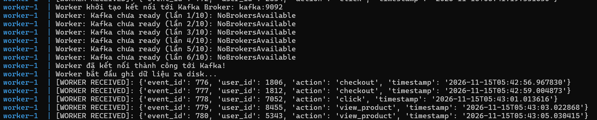
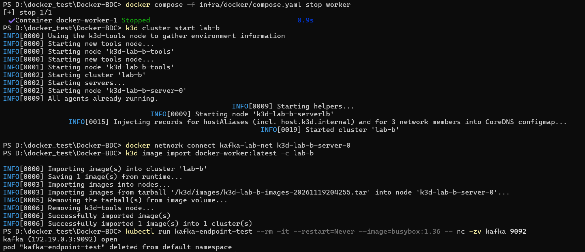
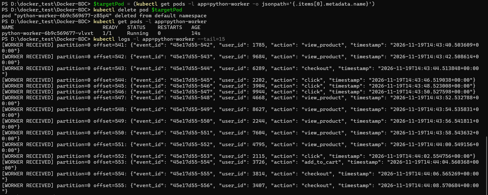
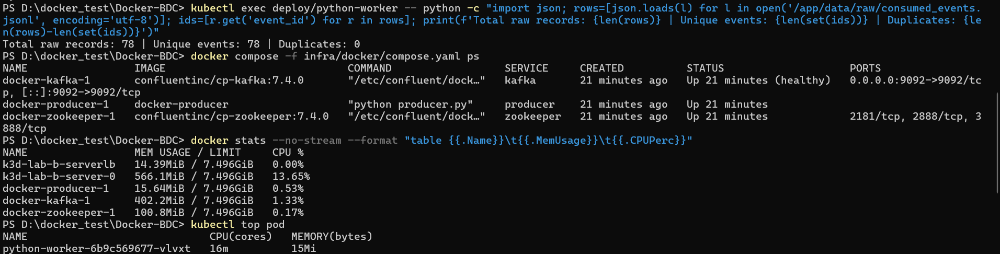

# Infrastructure Engineer: Docker Compose (Lab A) → Kubernetes `k3d` (Lab B)

Thư mục `infra/` chứa toàn bộ cấu hình hạ tầng, mã nguồn pipeline streaming (**Zookeeper**, **Apache Kafka**, **Python Producer**, **Python Stateless Worker**), tài liệu đánh giá hiệu năng và quyết định kiến trúc cho cả hai môi trường điều phối: **Docker Compose (Lab A)** và **Kubernetes `k3d` (Lab B)**.

---

## 1. Cấu trúc thư mục

```text
infra/
├── docker/
│   ├── data/raw/                # Thư mục bind-mount lưu output JSONL của Lab A
│   ├── src/
│   │   ├── producer.py          # Sinh sự kiện (run_id-counter, acks=all, SIGTERM)
│   │   ├── worker.py            # Consumer at-least-once (manual commit, fsync, heartbeat)
│   │   └── requirements.txt     # Thư viện Python (kafka-python)
│   ├── .dockerignore            # Loại trừ file thừa khi build image
│   ├── .env.example             # Mẫu biến môi trường cho Docker Compose
│   ├── .gitignore               # Bỏ qua .env và dữ liệu sinh ra cục bộ
│   ├── compose.yaml             # Định nghĩa 4 services trên mạng kafka-lab-net
│   └── Dockerfile               # Đóng gói image dùng chung cho Producer và Worker
├── k8s/
│   ├── configmap.yaml           # Cấu hình Kafka & tách riêng KAFKA_GROUP_ID cho K8s
│   ├── deployment.yaml          # Deployment Stateless Worker (emptyDir, 3 probes)
│   ├── secret_example.yaml      # Mẫu Secret (commit lên Git)
│   └── secret.yaml              # Secret thực tế (được ignore bởi Git)
├── evidence/                    # Ảnh chụp bằng chứng kiểm thử Lab B
├── image/                       # Ảnh chụp bằng chứng kiểm thử Lab A
├── adr-compose-vs-k8s.md        # Architecture Decision Record: Compose vs. K8s
├── benchmark.md                 # Báo cáo đo đạc tài nguyên, self-healing & replay
└── README.md                    # Tài liệu hướng dẫn vận hành & xử lý sự cố
```

---

## 2. Lab A — Docker Compose (Local Development)

### 2.1. Setup (Cài đặt & Khởi chạy)

Thực hiện các lệnh sau từ thư mục `infra/docker/`:

```powershell
# 1. Di chuyển vào thư mục Docker Compose
cd infra/docker

# 2. Tạo file biến môi trường từ bản mẫu
cp .env.example .env

# 3. Build image và khởi chạy toàn bộ hệ thống trên mạng kafka-lab-net
docker compose up -d --build

# 4. Kiểm tra trạng thái các container (kafka và worker đạt trạng thái healthy)
docker compose ps

# 5. Theo dõi luồng hoạt động của Producer và Worker
docker compose logs -f producer worker
```

### 2.2. Stop & Reset Volumes

```powershell
# Tạm dừng container (giữ nguyên dữ liệu và trạng thái)
docker compose stop

# Dừng và xóa container, giữ nguyên Docker Volumes và dữ liệu trong data/raw/
docker compose down
```

> **CẢNH BÁO MẤT DỮ LIỆU:** Lệnh `docker compose down -v` sẽ **xóa vĩnh viễn toàn bộ Docker Volumes** (topic, tin nhắn lưu trên Kafka, metadata Zookeeper và consumer offsets). Chỉ dùng khi cần làm sạch hoàn toàn môi trường.

```powershell
# Xóa sạch volumes và khởi tạo lại cụm trắng từ đầu
docker compose down -v
docker compose up -d --build
```

### 2.3. Kiểm thử vận hành & Khả năng chịu lỗi (Lab A Verification)

#### Test 1: Kiểm tra luồng End-to-End & định dạng `event_id` duy nhất
* **Mục tiêu:** Xác nhận `producer` sinh mã `event_id` dạng `<run_id>-<counter>` (không bị trùng ID khi restart) và `worker` ghi dữ liệu raw xuống `data/raw/consumed_events.jsonl`.
* **Lệnh thực hiện:**
  ```powershell
  docker compose ps
  docker compose logs --tail=10 producer worker
  (Get-Content data/raw/consumed_events.jsonl).Count
  ```

#### Test 2: Graceful Shutdown (`SIGTERM`) & Tự phục hồi (`restart: unless-stopped`)
* **Mục tiêu:** Kiểm chứng `worker` bắt tín hiệu `SIGTERM` để `fsync` + `commit()` offset và thoát êm trong ~1 giây (thay vì treo 10s chờ `SIGKILL`), sau đó tự động khởi động lại mà không mất/trùng dữ liệu.
* **Lệnh thực hiện:**
  ```powershell
  # 1. Kiểm tra thời gian dừng êm khi gửi SIGTERM qua compose stop (~1s)
  Measure-Command { docker compose stop worker }
  docker compose start worker

  # 2. Kích hoạt tiến trình PID 1 tự thoát bên trong container để kiểm tra auto-restart
  docker compose exec worker sh -c "kill -TERM 1"
  docker compose ps
  docker compose logs --tail=35 worker
  ```
* **Lưu ý kỹ thuật:** Dùng `sh -c "kill -TERM 1"` thay vì `docker kill` vì Docker Engine gắn cờ dừng thủ công (`ManuallyStopped`) nếu gọi stop/kill từ bên ngoài và sẽ không tự bật lại dù cấu hình `restart: unless-stopped`.
* **Minh chứng:**
  

#### Test 3: Gián đoạn Kafka Broker & Cơ chế Retry Exponential Backoff
* **Mục tiêu:** Kiểm chứng `producer` và `worker` bắt lỗi mất kết nối, thử lại giãn cách lũy tiến (`2s → 4s → 8s → 16s`) và tự khôi phục khi Kafka bật lại.
* **Lệnh thực hiện:**
  ```powershell
  docker compose stop kafka
  docker compose logs --tail=15 producer worker
  docker compose start kafka
  ```
* **Minh chứng:**
  

#### Test 4: Kiểm tra cấu hình bắt buộc & Cơ chế Fail-Fast
* **Mục tiêu:** Xác nhận container dừng ngay lập tức với mã thoát `1` kèm thông báo lỗi rõ ràng ra `stderr` khi thiếu biến `KAFKA_BROKER`.
* **Lệnh thực hiện:**
  ```powershell
  docker compose run --rm -e KAFKA_BROKER="" worker
  $LASTEXITCODE
  ```
* **Kết quả thực tế:** In thông báo `LỖI: Thiếu biến môi trường bắt buộc KAFKA_BROKER!` và trả về `$LASTEXITCODE = 1`.
* **Minh chứng:**
  

---

## 3. Lab B — Kubernetes Local PoC (`k3d`)

Trong Lab B, **Kafka, Zookeeper và Producer** tiếp tục chạy nền ở Lab A, trong khi **Stateless Worker** được triển khai lên cụm Kubernetes `k3d` (`replicas: 1`, `emptyDir: {}`, `KAFKA_GROUP_ID="k8s-worker-group"`).

### 3.1. Khởi tạo cụm `k3d`, nối mạng & nạp Image

Thực hiện từ thư mục gốc `Docker-BDC/`:

```powershell
# 1. Dừng worker bên Docker Compose để tiết kiệm RAM và tránh chạy trùng worker
docker compose -f infra/docker/compose.yaml stop worker

# 2. Tạo cụm k3d (tắt Traefik để tiết kiệm RAM cho WSL2)
k3d cluster create lab-b --k3s-arg "--disable=traefik@server:0"

# 3. Nối node k3d vào mạng kafka-lab-net để Pod phân giải được tên miền kafka:9092
docker network connect kafka-lab-net k3d-lab-b-server-0

# 4. Nạp image docker-worker:latest từ máy local vào cụm k3d
k3d image import docker-worker:latest -c lab-b
```

### 3.2. Triển khai các Manifest Kubernetes

```powershell
# 1. Tạo file secret.yaml từ bản mẫu (nếu chưa có)
cp infra/k8s/secret_example.yaml infra/k8s/secret.yaml

# 2. Áp dụng ConfigMap, Secret và Deployment
kubectl apply -f infra/k8s/configmap.yaml
kubectl apply -f infra/k8s/secret.yaml
kubectl apply -f infra/k8s/deployment.yaml

# 3. Theo dõi quá trình rollout và kiểm tra trạng thái Pod + 3 Heartbeat Probes
kubectl rollout status deployment/python-worker
kubectl get pods -l app=python-worker
kubectl describe pod -l app=python-worker | Select-String "Image:|Limits:|Requests:|Liveness:|Readiness:|Startup:"
```
* **Minh chứng:**
  
### 3.3. Kiểm thử vận hành trên Kubernetes (Lab B Verification)

#### Test 1: Kiểm chứng DNS & kết nối Endpoint `kafka:9092` từ trong Cluster
```powershell
kubectl run kafka-endpoint-test --rm -it --restart=Never --image=busybox:1.36 -- nc -zv kafka 9092
```
* **Kết quả kỳ vọng:** Trả về `kafka (172.19.0.3:9092) open` và tự xóa Pod test ngay sau khi kiểm tra.
* **Minh chứng:**
  
#### Test 2: Cập nhật cuốn chiếu (`kubectl rollout restart`)
```powershell
kubectl rollout restart deployment/python-worker
kubectl rollout status deployment/python-worker
kubectl get pods -l app=python-worker
kubectl logs -l app=python-worker --tail=15
```
* **Kết quả kỳ vọng:** Nhờ `SIGTERM` handler, Pod cũ commit offset cuối và tắt ngay (~1s); Pod mới khởi tạo sạch (`RESTARTS: 0`) và đọc nối tiếp chính xác `offset` kế tiếp từ Kafka.
* **Minh chứng:**
  
#### Test 3: Xóa Pod đột ngột (`kubectl delete pod`) & Tự phục hồi (Self-healing)
```powershell
$targetPod = (kubectl get pods -l app=python-worker -o jsonpath='{.items[0].metadata.name}')
kubectl delete pod $targetPod
kubectl get pods -l app=python-worker
kubectl logs -l app=python-worker --tail=15
```
* **Kết quả kỳ vọng:** Controller `ReplicaSet` lập tức tạo Pod thay thế để duy trì `1/1 Running` và tiếp tục đọc dữ liệu từ mốc offset đã commit gần nhất.
* **Minh chứng:**
  
#### Test 4: Truy vấn Raw Counts & Đánh giá Duplicate / Event Replay
```powershell
# Đếm tổng số bản ghi raw, số event duy nhất và số bản ghi trùng lặp bên trong Pod
kubectl exec deploy/python-worker -- python -c "import json; rows=[json.loads(l) for l in open('/app/data/raw/consumed_events.jsonl', encoding='utf-8')]; ids=[r.get('event_id') for r in rows]; print(f'Total raw records: {len(rows)} | Unique events: {len(set(ids))} | Duplicates: {len(rows)-len(set(ids))}')"

# Đo mức tiêu thụ tài nguyên thực tế
docker stats --no-stream --format "table {{.Name}}\t{{.MemUsage}}\t{{.CPUPerc}}"
kubectl top pod
```
* **Giải thích hành vi dữ liệu:** Vì `deployment.yaml` sử dụng ổ đĩa tạm `emptyDir: {}` để giữ Pod hoàn toàn *stateless*, file `consumed_events.jsonl` cục bộ gắn với vòng đời của từng Pod (bị dọn dẹp khi Pod cũ bị xóa, và Pod mới chỉ ghi các bản ghi phát sinh từ mốc offset tiếp theo). Nhờ cơ chế `enable_auto_commit=False`, `os.fsync()` trước `commit()` và tắt êm qua `SIGTERM`, tỷ lệ trùng lặp (`Duplicates`) đạt `0` trong các lần tắt có kiểm soát.


### 3.4. Tạm dừng / Xóa cụm Lab B

```powershell
# Tạm dừng cụm k3d để giải phóng ~580 MiB RAM cho WSL2 (giữ nguyên cấu hình cụm)
k3d cluster stop lab-b

# Hoặc xóa hoàn toàn cụm k3d khi kết thúc bài lab
k3d cluster delete lab-b
```

---

## 4. Xử lý sự cố thường gặp (Troubleshooting)

| Triệu chứng lỗi | Nguyên nhân | Cách khắc phục |
| :--- | :--- | :--- |
| `UnknownHostException: zookeeper` khi khởi động `kafka` | Container `zookeeper` cũ vẫn bám mạng `default` trong khi `kafka` chạy trên `kafka-lab-net`. | Chạy `docker compose down -v`, xóa mạng cũ `docker network rm docker_default` rồi `docker compose up -d`. |
| Pod worker kẹt ở `ImagePullBackOff` hoặc `ErrImageNeverPull` | Image `docker-worker:latest` mới build chưa được nạp vào node của `k3d`. | Chạy `k3d image import docker-worker:latest -c lab-b` rồi `kubectl rollout restart deployment/python-worker`. |
| Pod worker không kết nối được `kafka:9092` | Node `k3d-lab-b-server-0` chưa được nối vào mạng Docker `kafka-lab-net`. | Chạy `docker network connect kafka-lab-net k3d-lab-b-server-0`. |
| `docker-kafka-1` thoát mã `1` / `137` trên WSL2 | Thiếu RAM khi chạy đồng thời cả Lab A và Lab B. | Tắt `worker` của Compose (`docker compose stop worker`) khi test Lab B, hoặc dừng `k3d` (`k3d cluster stop lab-b`) khi test Lab A. |

---

## 5. Tài liệu Kiến trúc & Đánh giá Thực nghiệm

* **Báo cáo đo lường & Phân tích Replay:**  [`benchmark.md`](./benchmark.md).
* **Quyết định lựa chọn nền tảng (ADR):**  [`adr-compose-vs-k8s.md`](./adr-compose-vs-k8s.md).