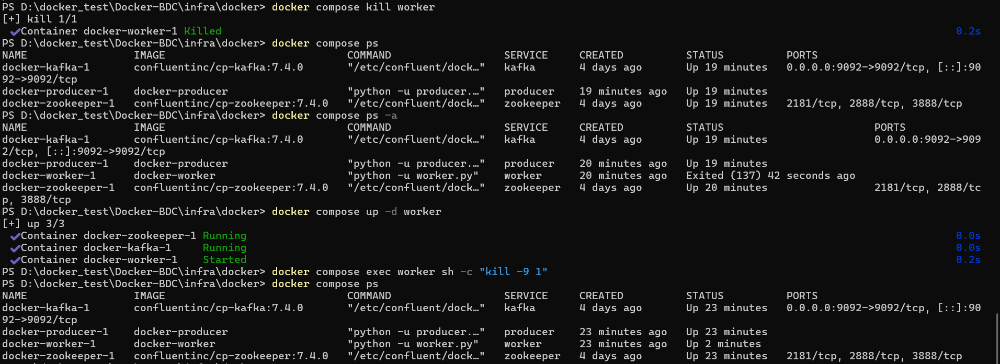
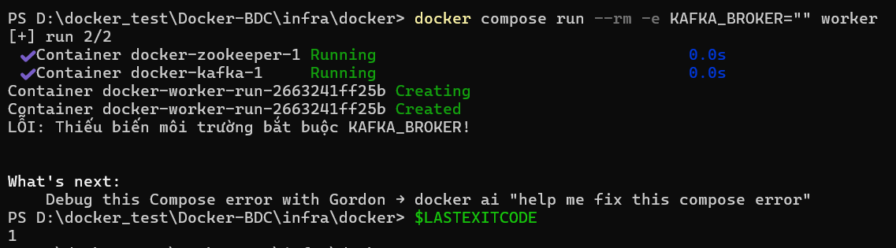

# Infrastructure Engineer: Docker → Kubernetes

Thư mục này chứa cấu hình hạ tầng cục bộ để vận hành pipeline thu thập và xử lý sự cố thời gian thực gồm: **Zookeeper**, **Kafka**, **Producer** và **Worker**.

## 1. Cấu trúc thư mục

```text
infra/
├── docker/
│   ├── src/
│   │   ├── producer.py          # Sinh dữ liệu sự kiện và gửi vào Kafka topic
│   │   ├── worker.py            # Đọc sự kiện từ Kafka và ghi ra file JSONL
│   │   └── requirements.txt     # Danh sách thư viện Python
│   ├── data/raw/                # Thư mục lưu dữ liệu đầu ra trên máy host
│   ├── Dockerfile               # Đóng gói image cho Producer và Worker
│   ├── compose.yaml             # Định nghĩa services, network, volumes và restart policy
│   ├── .dockerignore            # Loại trừ file thừa khi build image
│   └── .env.example             # Mẫu cấu hình biến môi trường
└── README.md                    # Tài liệu hướng dẫn vận hành và xử lý sự cố
```

---

## 2. Setup (Cài đặt & Khởi chạy)

Thực hiện các lệnh sau từ thư mục `infra/docker/`:

```bash
# 1. Di chuyển vào thư mục chứa compose.yaml
cd docker

# 2. Tạo file biến môi trường từ bản mẫu
cp .env.example .env

# 3. Build image và khởi chạy toàn bộ hệ thống ở chế độ nền
docker compose up -d --build

# 4. Kiểm tra trạng thái các container (tất cả phải ở trạng thái Up)
docker compose ps

# 5. Theo dõi luồng hoạt động của Producer và Worker
docker compose logs -f producer worker
```

---

## 3. Stop (Dừng hệ thống — Giữ nguyên dữ liệu)

Tạm ngưng hay giải phóng container (cả hai đều bảo toàn dữ liệu trong Docker Volumes và thư mục `data/raw/`):

```bash
# Cách 1: Tạm dừng các container đang chạy (khởi động lại bằng `docker compose start`)
docker compose stop

# Cách 2: Dừng và xóa toàn bộ container, network nhưng GIỮ NGUYÊN volumes dữ liệu
docker compose down
```

---

## 4. Reset Volumes (Xóa sạch dữ liệu & Khởi tạo lại)

> **CẢNH BÁO MẤT DỮ LIỆU:** Lệnh `docker compose down -v` sẽ **xóa vĩnh viễn toàn bộ Docker Volumes** gắn với dự án. Mọi topic, tin nhắn đang lưu trong Kafka, metadata của Zookeeper và vị trí đọc (`consumer offsets`) sẽ bị mất hoàn toàn và không thể khôi phục. Chỉ sử dụng lệnh này khi muốn làm sạch môi trường hoặc sửa lỗi lệch trạng thái cụm.

```bash
# 1. Dừng hệ thống và xóa sạch toàn bộ Docker Volumes
docker compose down -v

# 2. Khởi tạo lại hệ thống trắng từ đầu
docker compose up -d --build
```

---

## 5. Kiểm thử vận hành & Khả năng chịu lỗi (Lab A Verification)

### Test 1: Worker Crash & Tự phục hồi (`restart: unless-stopped`)
* **Mục tiêu:** Kiểm chứng container `worker` tự động khởi động lại khi tiến trình chính (PID 1) gặp sự cố sập đột ngột.
* **Lệnh thực hiện:**
  ```bash
  docker compose exec worker sh -c "kill -9 1"
  docker compose ps
  ```
* **Kết quả kỳ vọng:** Container `docker-worker-1` thoát với mã `137` và tự động bật lại sau vài giây, tiếp tục tiêu thụ các sự kiện tiếp theo từ Kafka mà không mất dữ liệu.
* **Minh chứng:**
  

---

### Test 2: Gián đoạn Kafka Broker & Cơ chế Retry
* **Mục tiêu:** Kiểm chứng ứng dụng không bị crash khi mất kết nối tạm thời tới Kafka mà tự động thử lại giãn cách lũy tiến.
* **Lệnh thực hiện:**
  ```bash
  docker compose stop kafka
  # Chờ 15-20 giây để quan sát log retry của Producer và Worker
  docker compose logs --tail=20 producer worker
  docker compose start kafka
  ```
* **Kết quả kỳ vọng:** Producer và Worker bắt lỗi mất kết nối, thực hiện retry với thời gian chờ tăng dần và tự động khôi phục luồng gửi/nhận dữ liệu ngay khi Kafka hoạt động trở lại.
* **Minh chứng:**
  

---

### Test 3: Kiểm tra cấu hình bắt buộc & Cơ chế Fail-Fast (Missing Required Env)
* **Mục tiêu:** Kiểm chứng ứng dụng chủ động xác thực cấu hình đầu vào ngay lúc khởi động và dừng ngay lập tức (fail-fast) kèm thông báo rõ ràng khi thiếu biến môi trường bắt buộc (`KAFKA_BROKER`), tránh tình trạng container chạy treo hoặc ghi sai dữ liệu.
* **Lệnh thực hiện:**
  ```powershell
  # Chạy thử container worker với biến KAFKA_BROKER bị bỏ trống
  docker compose run --rm -e KAFKA_BROKER="" worker

  # Kiểm tra mã thoát (Exit Code) trên PowerShell
  $LASTEXITCODE
  ```
* **Kết quả thực tế:** Container `worker` dừng ngay lập tức sau khi khởi tạo, in ra thông báo `LỖI: Thiếu biến môi trường bắt buộc KAFKA_BROKER!` và trả về mã thoát `1` (`Exit Code 1`); cờ `--rm` tự động dọn dẹp container tạm sau khi thoát.
* **Minh chứng:**
  