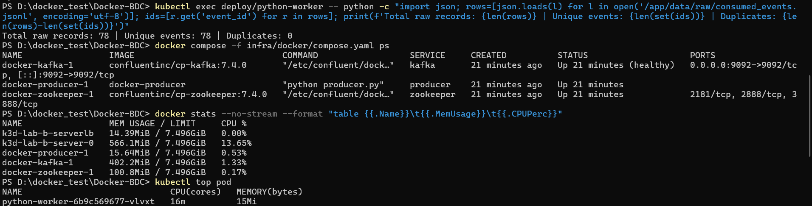
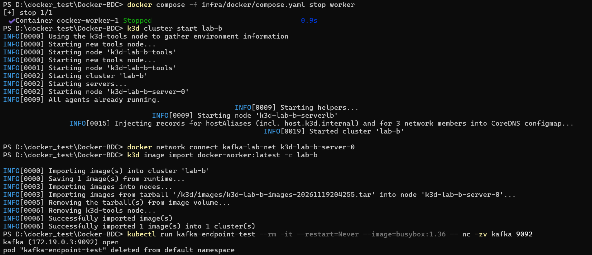
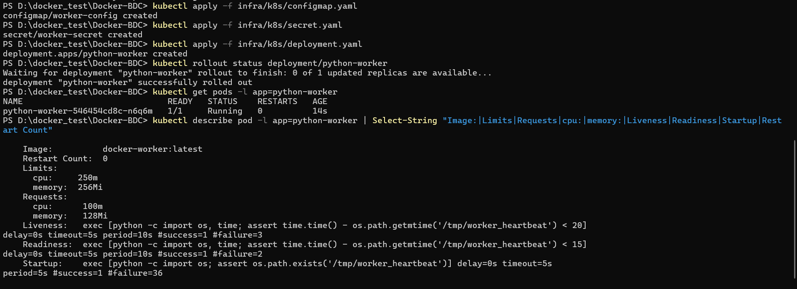
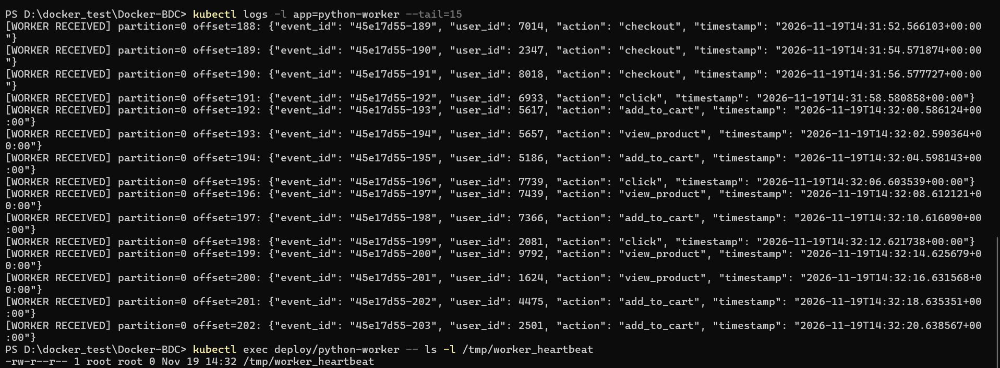
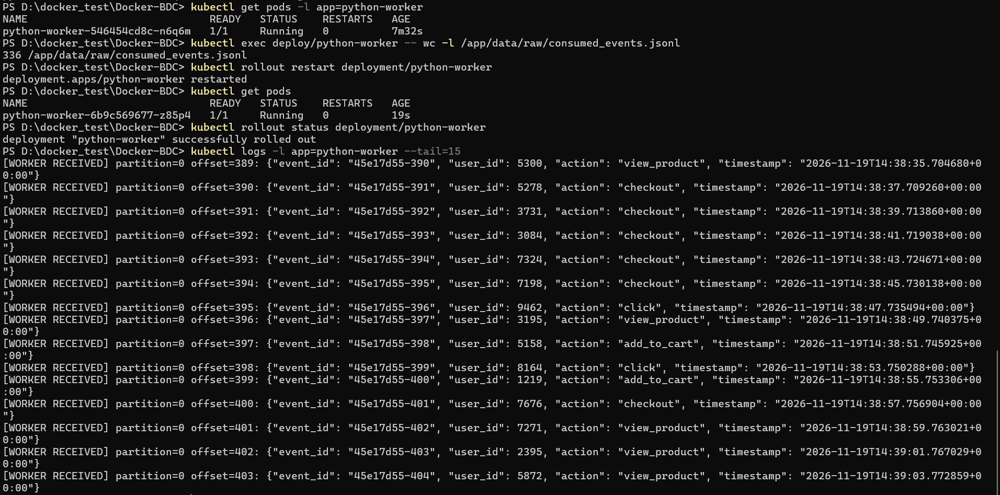
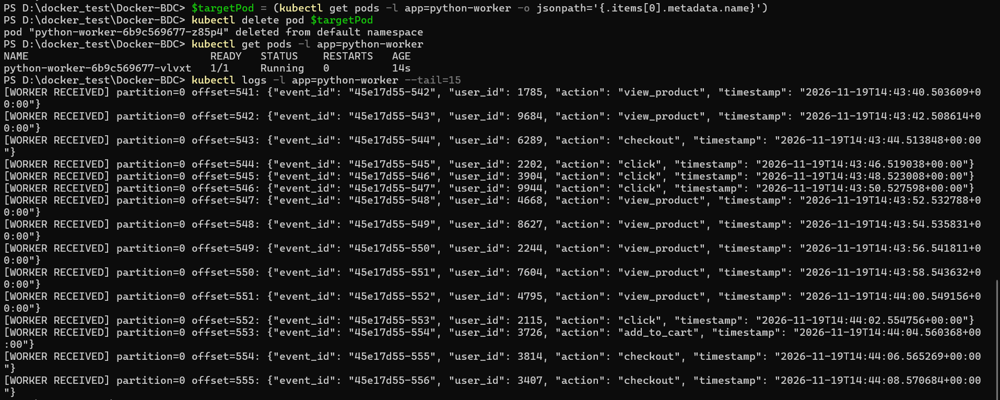

# Benchmark: Docker Compose vs Kubernetes (k3d)

**Môi trường:** Windows + Docker Desktop (RAM cấp cho Docker 7.5 GiB).
- **Compose:** Zookeeper + Kafka (`cp-*:7.4.0`) + producer + worker.
- **K8s:** cluster `k3d` `lab-b` (1 server node), chỉ chạy **worker** (`docker-worker:latest`, `replicas: 1`, `strategy: Recreate`, `emptyDir`),  được nối vào mạng `kafka-lab-net`.
- **Endpoint đã kiểm chứng:** Pod `busybox` chạy `nc -zv kafka 9092` → `kafka (172.19.0.3:9092) open`.

## 1. So sánh

| Tiêu chí | Compose | K8s (k3d) |
|---|---|---|
| **Setup** | **≈5-6 s** (`down` rồi đo `docker compose up -d`, có chờ Kafka healthy) | **≈39 s** = start cluster 19 s + import image 6 s + worker Ready ≤14 s (cluster đã tạo sẵn) |
| **RAM** | Kafka + ZK + producer = **517.6 MiB**; cộng worker (~15 MiB) ≈ **534 MiB** | Thêm node k3d + serverlb = 580.5 MiB (đã gồm Pod worker 15 MiB) → tổng ≈ **1099 MiB** (~2× Compose). |
| **Độ phức tạp** | `compose.yaml` + Dockerfile + `.env` | Thêm 3 manifest (ConfigMap, Secret, Deployment) và 3 bước ngoài manifest: `docker network connect`, `k3d image import`, kiểm chứng endpoint |
| **Self-healing** | Tiến trình tự thoát → `restart: unless-stopped` bật lại. `docker kill/stop` là dừng thủ công nên **không** tự bật lại. | Xóa Pod → ReplicaSet tạo Pod mới `1/1 Running`. `rollout restart` tạo ReplicaSet mới (`n6q6m` → `z85p4`) và Pod mới `1/1 Running`. |
| **Troubleshooting** | `compose ps/logs` thường đủ. Lỗi gặp thật: `kill` không có trong container (phải `sh -c`); hiểu nhầm `docker kill` sẽ tự restart | Nhiều lớp: `get pods` → `describe` → `logs` → `exec`. Bước thủ công dễ sót: nối mạng và import image |

## 2. RAM đo được (`docker stats`, `kubectl top`)

| Thành phần | RAM | CPU |
|---|---|---|
| `docker-kafka-1` | 402.2 MiB | 1.33% |
| `docker-zookeeper-1` | 100.8 MiB | 0.17% |
| `docker-producer-1` | 15.64 MiB | 0.53% |
| `k3d-lab-b-server-0` (gồm Pod worker) | 566.1 MiB | 13.65% |
| `k3d-lab-b-serverlb` | 14.39 MiB | 0.00% |
| Pod `python-worker-6b9c569677-vlvxt` | 15 MiB (req 128Mi / lim 256Mi) | 16m (req 100m / lim 250m) |

## 3. Thử nghiệm trên K8s

- **Resources & probes** (`describe pod`): requests 100m/128Mi, limits 250m/256Mi. Startup (period 5 s, failure 36), liveness (heartbeat < 20 s, period 10 s, failure 3), readiness (< 15 s, period 10 s, failure 2) đều đọc mtime `/tmp/worker_heartbeat`. Pod `1/1`, RESTARTS 0; file heartbeat tồn tại.
- **`rollout restart`:** Pod `n6q6m` (7m32s, raw 336 dòng) được thay bằng `z85p4` `1/1 Running` (AGE 19 s), tiếp tục nhận event (`offset=389..403`, `event_id` tăng đều).
- **Xóa Pod:** `z85p4` bị xóa → `vlvxt` `1/1 Running` (AGE 14 s), nhận event tiếp (`offset=541..555`).
- **Duplicate/replay:** raw của Pod hiện tại có 78 bản ghi, 78 `event_id` duy nhất, **0 trùng**. **Giới hạn:** `emptyDir` tạo file mới cho mỗi Pod nên phép đếm này chỉ kiểm tra trong vòng đời một Pod. 

## 4. Kết luận

- **Service restart ≠ data correctness.** K8s tự đưa worker về `Running` sau khi xóa Pod hoặc rollout, nhưng file raw trong `emptyDir` mất theo Pod (336 dòng của Pod cũ không còn, Pod mới ghi file mới) trong khi offset trên Kafka vẫn tiến.

## Evidence
- RAM, raw count

---
- cluster, endpoint

 
---
- deploy, probes, heartbeat

 
 
---
- rollout restart

---
- xóa Pod (self_healing)

